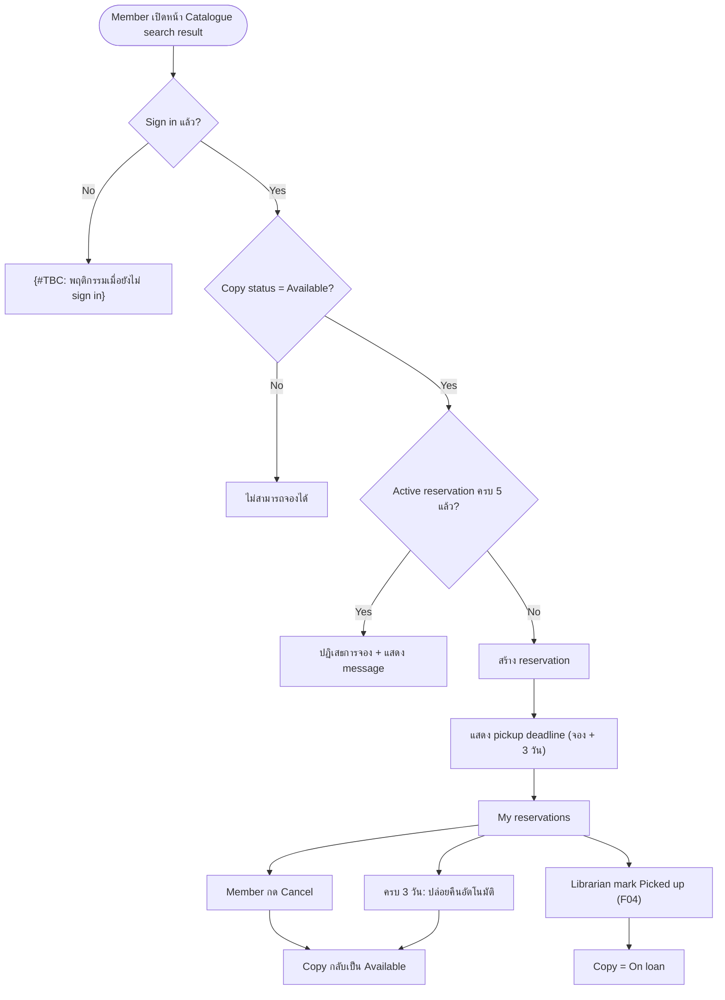

# [ALL][NEW] F03: Member reserves a book online

---

## Section 1: Document Information

|                            |                                                                                  |
| -------------------------- | -------------------------------------------------------------------------------- |
| **Feature Name**           | Member reserves a book online                                                    |
| **Epic**                   | [TBD]                                                                            |
| **User Story**             | [TBD]                                                                            |
| **Changes**                | NEW                                                                              |
| **UI Reference**           | ไม่มี mockup — features/DE-1/business-requirement/reference/ ไม่มีไฟล์            |
| **Backend Specification**  | [TBD]                                                                            |
| **Frontend Specification** | [TBD]                                                                            |
| **Document Status**        | DRAFT                                                                            |
| **Version**                | 1.0                                                                              |
| **Last Updated**           | 2026-11-03T14:30:13Z                                                             |
| **Change Summary**         | V1.0: ครอบคลุมการจองเล่มที่ว่างจากหน้า Catalogue, การจำกัด 5 active reservation, การถือสิทธิ์ 3 วัน, และหน้า My reservations (view / cancel) |
| **Document Owner**         | [TBD]                                                                            |
| **SA Owner**               | [TBD]                                                                            |
| **Designer Owner**         | [TBD]                                                                            |

### Legend

| Mark                                          | Meaning                                                         |
| --------------------------------------------- | --------------------------------------------------------------- |
| _(no mark)_                                   | No changes                                                      |
| <span style="color:green">green</span>        | New requirement                                                 |
| <span style="color:blue">blue</span>          | Changed from existing requirement                               |
| <span style="color:red"><del>red</del></span> | Removed from existing requirement                               |
| <span style="color:orange">orange</span>      | Designed for future support, not in current scope (not scored)  |
| **{#TBC}**                                    | To be confirmed                                                 |
| **[TBD]**                                     | To be determined                                                |
| **[รอ SA กำหนด]**                             | Technical / non-functional — รอ SA กำหนด (ไม่ใช่ open question) |

### Change History

| Version | Date (UTC)           | Author | Summary                                       |
| ------- | -------------------- | ------ | --------------------------------------------- |
| 1.0     | 2026-11-03T14:30:13Z | [TBD]  | Initial BFS draft จาก backlog DE-1            |

---

## Section 2: Overview

### Requirement Summary

> Library member ต้องการจองเล่มหนังสือที่ว่าง (Available) จากหน้า Catalogue เพื่อไปรับที่สาขาโดยไม่ต้องโทรหา front desk
> ปัจจุบันสมาชิกต้องโทรหา front desk เพื่อจองหนังสือ
> _Feature นี้ครอบคลุม: ปุ่ม Reserve ที่หน้า Catalogue search result, การจำกัด active reservation สูงสุด 5 รายการต่อ Member, การถือสิทธิ์ 3 วันแล้วปล่อยคืนอัตโนมัติ, การแสดง pickup deadline, และหน้า My reservations (ดูรายการ / Cancel)_
> ผลลัพธ์ที่คาดหวัง: Member จองเล่มที่ว่างได้เอง เห็น pickup deadline ทันที และจัดการรายการจองของตนเองได้

---

## Section 3: Scope Definition

### 3.1 In Scope

- Reserve copy ที่มีสถานะ Available จากหน้า Catalogue search result (เฉพาะ Member ที่ sign in แล้ว)
- ตรวจจำนวน active reservation สูงสุด 5 รายการต่อ Member (รายการที่ 6 ถูกปฏิเสธพร้อม message)
- ถือสิทธิ์การจอง 3 วัน แล้วปล่อยคืนอัตโนมัติ (copy กลับเป็น Available)
- แสดง pickup deadline ทันทีหลังจอง และในหน้า My reservations
- หน้า My reservations: list (title, branch, pickup deadline) และปุ่ม Cancel

### 3.2 Out of Scope

- Member Sign-in — แยกเป็น F01
- Catalogue Search (การค้นหา และการแสดงสถานะว่ามีเล่มว่าง) — แยกเป็น F02
- Librarian mark reservation เป็น Picked up และ copy เปลี่ยนเป็น On loan — แยกเป็น F04 (Librarian Reservation Management) {#TBC: ยืนยันว่า flow Picked up / On loan อยู่ใน F04 ทั้งหมด ไม่ต้องระบุใน BFS นี้}
- Payments, fines, e-books, mobile app (ตาม context guidance)

### 3.3 Limitations

- Web application, UI 2 ภาษา (ไทย/อังกฤษ)
- ไม่มี external integration นอกจาก PostgreSQL เดิมของห้องสมุด

---

## Section 4: High-Level Business Flow



---

## Section 5: Functional Requirements

> **Note:** Each sub-section below = 1 Functional Requirement

---

### 5.1 Reserve a book from Catalogue

**User Story**

> As a `Member`, I want to reserve an available copy of a book from the catalogue page, so that I can pick it up at the branch without calling the front desk.

**References**

| Field                  | Value                                                  |
| ---------------------- | ------------------------------------------------------ |
| Epic                   | [TBD]                                                  |
| User Story             | [TBD]                                                  |
| UI Reference           | ไม่มี (features/DE-1/business-requirement/input/requirement.md) |
| Backend Specification  | [TBD]                                                  |
| Frontend Specification | [TBD]                                                  |
| Menu Navigation        | Catalogue search result {#TBC: path/ชื่อเมนูของหน้า Catalogue} |

---

**Use Case Flow**

| Actor  | Step | Pre-condition                                            | Action                                       | Expected Result                                                                                      |
| ------ | ---- | -------------------------------------------------------- | -------------------------------------------- | ---------------------------------------------------------------------------------------------------- |
| Member | 1    | Sign in แล้ว; อยู่ที่หน้า Catalogue search result        | ดูรายการ copy ของหนังสือ                     | แสดงปุ่ม Reserve ที่ copy แต่ละเล่มที่มีสถานะ Available                                              |
| Member | 2    | Copy สถานะ Available; active reservation ของ Member < 5  | กดปุ่ม Reserve                               | ระบบสร้าง reservation, copy ไม่ว่างอีกต่อไป {#TBC: สถานะ copy หลังถูกจอง (Reserved หรือสถานะอื่น)}, แสดง pickup deadline ทันที {#TBC: รูปแบบ/wording การแสดง deadline และมี confirm dialog ก่อนจองหรือไม่} |
| Member | 3    | Active reservation ของ Member = 5 แล้ว                   | กดปุ่ม Reserve                               | ระบบปฏิเสธการจองและแสดง message {#TBC: wording ของ message}                                         |
| Member | 4    | Copy ถูก Member อื่นจองไปก่อนหน้าขณะที่หน้ายังแสดง Available | กดปุ่ม Reserve                            | {#TBC: ผลลัพธ์/message เมื่อ copy ไม่ Available แล้วตอนกดจอง}                                        |
| Guest  | 5    | ยังไม่ sign in                                           | กดปุ่ม Reserve                               | {#TBC: ปุ่ม Reserve แสดงหรือไม่เมื่อยังไม่ sign in และเมื่อกดให้เกิดอะไรขึ้น (เช่น ไป Sign-in)}      |

---

**Field Conditions**

| Field ID                         | Field Name       | Field Specifications                                                                                                                 | Field Conditions                                                                                                                                                                                                                                                                  |
| -------------------------------- | ---------------- | ------------------------------------------------------------------------------------------------------------------------------------ | --------------------------------------------------------------------------------------------------------------------------------------------------------------------------------------------------------------------------------------------------------------------------------- |
| `RESERVATION.CATALOGUE.reserve`  | Reserve (button) | Field Type: Button<br>Possible Value: -<br>Data Type: -<br>Mandatory: -<br>Format: -                                                | **Condition 1: When copy status = Available Then Show**<br><br>**Case 1:** แสดงปุ่ม Reserve ที่ copy นั้น<br><br>**Condition 2: When copy status ≠ Available Then Do**<br><br>**Case 1:** ไม่สามารถจองได้ {#TBC: ซ่อนปุ่ม หรือแสดงแต่ disable}                                   |
| `RESERVATION.CATALOGUE.pickupDeadline` | Pickup deadline | Field Type: Text (read-only)<br>Possible Value: -<br>Data Type: Date/Time<br>Mandatory: -<br>Format: {#TBC: รูปแบบวันที่/เวลา} | **Condition 1: When reservation ถูกสร้างสำเร็จ Then Show**<br><br>**Case 1:** แสดง pickup deadline = เวลาที่จอง + 3 วัน {#TBC: นับ 3 วันตามเวลาที่จองพอดี หรือสิ้นสุดวันที่ 3 และ time zone}                                                                                  |

---

**Acceptance Criteria**

**Scenario 1: Member จองเล่มที่ว่างสำเร็จ**

```
Given   Member sign in แล้ว และมี active reservation น้อยกว่า 5 รายการ
And     copy มีสถานะ Available
When    Member กดปุ่ม Reserve
Then    ระบบสร้าง reservation
And     แสดง pickup deadline ให้ Member เห็นทันที
```

**Scenario 2: Member ครบ 5 active reservation**

```
Given   Member sign in แล้ว และมี active reservation 5 รายการ
When    Member กดปุ่ม Reserve ที่ copy ที่ Available
Then    ระบบปฏิเสธการจอง
And     แสดง message ว่าจองเกินจำนวนที่กำหนด {#TBC: wording}
```

**Scenario 3: Copy ไม่ใช่ Available**

```
Given   copy มีสถานะอื่นที่ไม่ใช่ Available
When    Member เปิดหน้า Catalogue search result
Then    Member ไม่สามารถจอง copy นั้นได้
```

---

### 5.2 View and cancel reservations (My reservations)

**User Story**

> As a `Member`, I want to see my reservations with their pickup deadline and cancel them, so that I know when to pick up and can release copies I no longer need.

**References**

| Field                  | Value                                                  |
| ---------------------- | ------------------------------------------------------ |
| Epic                   | [TBD]                                                  |
| User Story             | [TBD]                                                  |
| UI Reference           | ไม่มี (features/DE-1/business-requirement/input/requirement.md) |
| Backend Specification  | [TBD]                                                  |
| Frontend Specification | [TBD]                                                  |
| Menu Navigation        | My reservations {#TBC: path/ตำแหน่งเมนู}               |

---

**Use Case Flow**

| Actor  | Step | Pre-condition                          | Action                          | Expected Result                                                                                         |
| ------ | ---- | -------------------------------------- | ------------------------------- | ------------------------------------------------------------------------------------------------------- |
| Member | 1    | Sign in แล้ว                           | เปิดหน้า My reservations        | แสดง list ของ reservation: title, branch, pickup deadline และปุ่ม Cancel {#TBC: เรียงลำดับ, แสดงเฉพาะ active หรือรวมประวัติ} |
| Member | 2    | ไม่มี reservation                      | เปิดหน้า My reservations        | {#TBC: empty state wording}                                                                             |
| Member | 3    | มี reservation อย่างน้อย 1 รายการ      | กดปุ่ม Cancel                   | Reservation ถูกยกเลิก และ copy กลับเป็น Available {#TBC: ต้องมี confirm dialog หรือไม่ และ wording ของ toast} |
| ระบบ   | 4    | Reservation ถือครบ 3 วันแล้ว           | ระบบปล่อย reservation อัตโนมัติ | Copy กลับเป็น Available; reservation ไม่ active อีกต่อไป {#TBC: reservation ที่หมดอายุยังแสดงใน My reservations หรือไม่ และมีการแจ้ง Member หรือไม่} |

---

**Field Conditions**

| Field ID                              | Field Name      | Field Specifications                                                                              | Field Conditions                                                                                              |
| ------------------------------------- | --------------- | ------------------------------------------------------------------------------------------------- | ------------------------------------------------------------------------------------------------------------- |
| `RESERVATION.MY_RESERVATIONS.title`   | Title           | Field Type: Text (read-only)<br>Data Type: String<br>Mandatory: -<br>Format: -                   | **Condition 1: When แสดง list Then Show**<br><br>**Case 1:** ชื่อหนังสือของ reservation                       |
| `RESERVATION.MY_RESERVATIONS.branch`  | Branch          | Field Type: Text (read-only)<br>Data Type: String<br>Mandatory: -<br>Format: -                   | **Condition 1: When แสดง list Then Show**<br><br>**Case 1:** สาขาที่ Member ไปรับหนังสือ                      |
| `RESERVATION.MY_RESERVATIONS.pickupDeadline` | Pickup deadline | Field Type: Text (read-only)<br>Data Type: Date/Time<br>Mandatory: -<br>Format: {#TBC: รูปแบบ} | **Condition 1: When แสดง list Then Show**<br><br>**Case 1:** deadline เดียวกับที่แสดงตอนจอง (จอง + 3 วัน)      |
| `RESERVATION.MY_RESERVATIONS.cancel`  | Cancel (button) | Field Type: Button<br>Data Type: -<br>Mandatory: -<br>Format: -                                  | **Condition 1: When กด Cancel Then Do**<br><br>**Case 1:** ยกเลิก reservation, copy กลับเป็น Available, active reservation ของ Member ลดลง 1 |

---

**Acceptance Criteria**

**Scenario 1: ดูรายการจอง**

```
Given   Member sign in แล้ว และมี reservation
When    Member เปิดหน้า My reservations
Then    แสดง title, branch, pickup deadline และปุ่ม Cancel ของแต่ละรายการ
```

**Scenario 2: Cancel reservation**

```
Given   Member มี reservation ที่ active
When    Member กดปุ่ม Cancel
Then    reservation ถูกยกเลิก
And     copy กลับเป็น Available
```

**Scenario 3: Reservation ครบ 3 วัน**

```
Given   reservation ถูกถือครบ 3 วันและยังไม่ถูก mark Picked up
When    ถึง pickup deadline
Then    ระบบปล่อย reservation อัตโนมัติ
And     copy กลับเป็น Available
```

---

## Section 6: User Authorization Matrix

| Function                              | Member | Librarian | Guest (ยังไม่ sign in) |
| ------------------------------------- | :----: | :-------: | :--------------------: |
| Reserve copy                          |   ✔    |     —     |           —            |
| View My reservations                  |   ✔    |     —     |           —            |
| Cancel reservation (ของตนเอง)         |   ✔    |     —     |           —            |
| Mark Picked up (F04)                  |   —    |     ✔     |           —            |

{#TBC: Librarian reserve/cancel แทน Member ได้หรือไม่}

---

## Section 7: Additional Business Rules / Logic

1. **Sign-in required:** เฉพาะ Member ที่ sign in แล้วเท่านั้นที่จองได้
2. **Available only:** จองได้เฉพาะ copy ที่มีสถานะ Available
3. **Max active reservations:** Member มี active reservation ได้สูงสุด 5 รายการ; รายการที่ 6 ถูกปฏิเสธพร้อม message {#TBC: นิยามของ "active" — นับเฉพาะรายการที่ยังถือสิทธิ์อยู่ใช่หรือไม่}
4. **Hold period:** reservation ถือสิทธิ์ 3 วัน จากนั้นปล่อยอัตโนมัติและ copy กลับเป็น Available; กลไก scheduler [รอ SA กำหนด: วิธี/ความถี่การปล่อย reservation ที่หมดอายุและ concurrency ของการจอง copy เดียวกัน]
5. **Pickup deadline display:** Member เห็น pickup deadline ทันทีหลังจอง และในหน้า My reservations
6. **Picked up:** Librarian mark reservation เป็น Picked up แล้ว copy เป็น On loan (อยู่ใน F04)
7. **Same title:** {#TBC: Member จองหลาย copy ของหนังสือเรื่องเดียวกันได้หรือไม่}

---

## Section 8: Related Documents

| Document Name                                          | Document Link                                                |
| ------------------------------------------------------ | ------------------------------------------------------------ |
| F03: Member reserves a book online (Input Requirement) | features/DE-1/business-requirement/input/requirement.md      |
| Context Guidance                                       | INIT/project-overview/version-1/context-guidance.md          |
| F01: Member Sign-in (BFS)                              | [TBD]                                                        |
| F02: Catalogue Search (BFS)                            | [TBD]                                                        |
| F04: Librarian Reservation Management (BFS)            | [TBD]                                                        |

---
