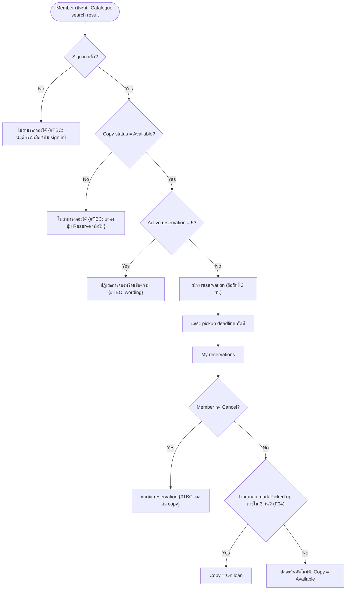

# [ALL][NEW] F03: Member reserves a book online

---

## Section 1: Document Information

|                            |                                                                    |
| -------------------------- | ------------------------------------------------------------------ |
| **Feature Name**           | Member reserves a book online                                      |
| **Epic**                   | [TBD]                                                              |
| **User Story**             | [TBD]                                                              |
| **Changes**                | NEW                                                                |
| **UI Reference**           | ไม่มีภาพ mockup ใน backlog นี้ (features/DE-1/business-requirement/reference ไม่มี) |
| **Backend Specification**  | {Link}                                                             |
| **Frontend Specification** | {Link}                                                             |
| **Document Status**        | DRAFT                                                              |
| **Version**                | 1.0                                                                |
| **Last Updated**           | 2026-11-03T14:25:52Z                                               |
| **Change Summary**         | V1.0: Draft แรก ครอบคลุมการจองหนังสือออนไลน์ของ Member (Reserve, My reservations, Cancel, ปล่อยคืนอัตโนมัติ 3 วัน, limit 5 รายการ) |
| **Document Owner**         | [TBD]                                                              |
| **SA Owner**               | {Owner Name}                                                       |
| **Designer Owner**         | {Owner Name}                                                       |

### Legend

| Mark                                          | Meaning                                                         |
| --------------------------------------------- | --------------------------------------------------------------- |
| _(no mark)_                                   | No changes                                                      |
| <span style="color:green">green</span>        | New requirement                                                 |
| <span style="color:blue">blue</span>          | Changed from existing requirement                               |
| <span style="color:red"><del>red</del></span> | Removed from existing requirement                               |
| <span style="color:orange">orange</span>      | Designed for future support, not in current scope (not scored)  |
| **{#TBC}**                                    | To be confirmed                                                 |
| **[TBD]**                                     | To be determined                                                |
| **[รอ SA กำหนด]**                             | Technical / non-functional — รอ SA กำหนด (ไม่ใช่ open question) |

### Change History

| Version | Date (UTC)           | Author  | Summary                                   |
| ------- | -------------------- | ------- | ----------------------------------------- |
| 1.0     | 2026-11-03T14:25:52Z | [TBD]   | Initial BFS draft จาก backlog DE-1        |

---

## Section 2: Overview

### Requirement Summary

> Member ของห้องสมุดต้องการจองหนังสือเล่มที่ว่าง (Available) จากหน้า Catalogue ออนไลน์ เพื่อไปรับที่สาขาโดยไม่ต้องโทรหา front desk
> ปัจจุบัน Member ต้องโทรหา front desk เพื่อจองหนังสือ
> _Feature นี้ครอบคลุม: ปุ่ม Reserve ในผลการค้นหา Catalogue, การแสดง pickup deadline หลังจอง, หน้า My reservations (รายการจอง + Cancel), limit active reservation 5 รายการ, และการปล่อยคืนอัตโนมัติเมื่อครบ 3 วัน_
> ผลลัพธ์ที่คาดหวัง: Member จองหนังสือเองได้ เห็น pickup deadline ชัดเจน และเล่มที่ไม่มารับถูกปล่อยกลับเป็น Available อัตโนมัติ

---

## Section 3: Scope Definition

### 3.1 In Scope

- ปุ่ม Reserve บนแต่ละ copy ที่ Available ในหน้า Catalogue search result
- การตรวจสิทธิ์: เฉพาะ Member ที่ sign in แล้วจึงจองได้
- limit active reservation สูงสุด 5 รายการต่อ Member (รายการที่ 6 ถูกปฏิเสธพร้อมข้อความ)
- การแสดง pickup deadline ทันทีหลังจอง และในหน้า My reservations
- หน้า My reservations: list แสดง title, branch, pickup deadline และปุ่ม Cancel
- การถือสิทธิ์ 3 วัน แล้วปล่อยคืนอัตโนมัติ และ copy กลับเป็น Available
- UI 2 ภาษา (ไทย/อังกฤษ) ตามระดับโปรเจกต์

### 3.2 Out of Scope

- Member Sign-in — F01
- Catalogue Search (การค้นหาและการแสดงสถานะ copy) — F02
- Librarian ดูรายการจองประจำวันและ mark Picked up (copy เป็น On loan) — F04 (ใน feature นี้อ้างถึงเฉพาะผลต่อ status ของ reservation/copy)
- Payments, fines, e-books, mobile app

### 3.3 Limitations

- Platform เป็น Web Application, ไม่มี external integration นอกจาก PostgreSQL เดิมของห้องสมุด

---

## Section 4: High-Level Business Flow



---

## Section 5: Functional Requirements

> **Note:** Each sub-section below = 1 Functional Requirement

---

### 5.1 Reserve an available copy

**User Story**

> As a `Member`, I want to reserve an available copy of a book from the catalogue page, so that I can pick it up at the branch without calling the front desk.

**References**

| Field                  | Value                                                    |
| ---------------------- | -------------------------------------------------------- |
| Epic                   | [TBD]                                                    |
| User Story             | [TBD]                                                    |
| UI Reference           | ไม่มี                                                    |
| Backend Specification  | {Link}                                                   |
| Frontend Specification | {Link}                                                   |
| Menu Navigation        | Catalogue search result {#TBC: path เมนู/URL ของหน้า Catalogue} |

---

**Use Case Flow**

| Actor  | Step | Pre-condition                                   | Action                                    | Expected Result |
| ------ | ---- | ----------------------------------------------- | ----------------------------------------- | --------------- |
| Member | 1    | Member sign in แล้ว และอยู่ที่ Catalogue search result | กดปุ่ม Reserve ของ copy ที่ Available     | ระบบตรวจว่า copy ยัง Available และ Member มี active reservation < 5 |
| Member | 2    | ผ่านการตรวจใน step 1                            | -                                         | ระบบสร้าง reservation, copy ไม่ Available อีกต่อไป {#TBC: ชื่อ status ของ copy ที่ถูกจอง}, แสดง pickup deadline ทันที {#TBC: wording/รูปแบบการแสดงผล (popup/toast/หน้า)} |
| Member | 3    | Member มี active reservation ครบ 5 รายการ       | กดปุ่ม Reserve                            | ระบบปฏิเสธการจองและแสดงข้อความ {#TBC: wording ข้อความเมื่อครบ 5 รายการ} |
| Member | 4    | ยังไม่ได้ sign in                               | พยายามจอง                                 | {#TBC: ระบบ redirect ไปหน้า sign in, ซ่อนปุ่ม Reserve หรือแสดงข้อความ} |
| Member | 5    | Copy ถูกจองโดยคนอื่นระหว่างที่ Member เปิดหน้าอยู่ | กดปุ่ม Reserve                            | {#TBC: ข้อความ/พฤติกรรมเมื่อ copy ไม่ Available แล้ว} |

---

**Field Conditions**

| Field ID                              | Field Name        | Field Specifications                                                                                   | Field Conditions |
| ------------------------------------- | ----------------- | ------------------------------------------------------------------------------------------------------ | ---------------- |
| `RESERVATION.CATALOGUE_RESULT.reserve_button` | Reserve (button)  | Field Type: Button<br>Possible Value: -<br>Data Type: -<br>Mandatory: -<br>Format: label "Reserve" (ตาม requirement; {#TBC: label ภาษาไทย}) | **Condition 1: When copy status = Available Then Do**<br><br>**Case 1:** แสดงปุ่ม Reserve บน copy นั้น<br><br>**Condition 2: When copy status ≠ Available Then Do**<br><br>**Case 1:** ไม่สามารถจองได้ {#TBC: ซ่อนปุ่ม หรือ disable} |
| `RESERVATION.CATALOGUE_RESULT.pickup_deadline` | Pickup deadline | Field Type: Label (read-only)<br>Possible Value: -<br>Data Type: Date/time {#TBC: date only หรือ date+time}<br>Mandatory: -<br>Format: {#TBC: รูปแบบวันที่ และ timezone} | **Condition 1: When reservation ถูกสร้างสำเร็จ Then Do**<br><br>**Case 1:** แสดง pickup deadline = เวลาที่จอง + 3 วัน {#TBC: นับ 3 วันเป็น 72 ชั่วโมง หรือสิ้นวันที่ 3} |

---

**Acceptance Criteria**

**Scenario 1: จองสำเร็จ**

```
Given   Member sign in แล้ว และมี active reservation น้อยกว่า 5 รายการ และ copy มี status Available
When    Member กดปุ่ม Reserve
Then    ระบบสร้าง reservation และแสดง pickup deadline ทันที
```

**Scenario 2: จองรายการที่ 6**

```
Given   Member มี active reservation 5 รายการ
When    Member กดปุ่ม Reserve ของ copy ที่ Available
Then    ระบบไม่สร้าง reservation และแสดงข้อความปฏิเสธ {#TBC: wording}
```

**Scenario 3: Member ยังไม่ sign in**

```
Given   ผู้ใช้ยังไม่ได้ sign in
When    ผู้ใช้พยายามจอง
Then    ระบบไม่สร้าง reservation {#TBC: พฤติกรรม UI}
```

**Scenario 4: Copy ไม่ Available**

```
Given   copy มี status ที่ไม่ใช่ Available
When    Member พยายามจอง
Then    ระบบไม่สร้าง reservation
```

---

### 5.2 View My reservations and Cancel

**User Story**

> As a `Member`, I want to see my reservations with their pickup deadline and cancel them, so that I know when to pick up and can release a copy I no longer need.

**References**

| Field                  | Value                                                    |
| ---------------------- | -------------------------------------------------------- |
| Epic                   | [TBD]                                                    |
| User Story             | [TBD]                                                    |
| UI Reference           | ไม่มี                                                    |
| Backend Specification  | {Link}                                                   |
| Frontend Specification | {Link}                                                   |
| Menu Navigation        | My reservations {#TBC: path เมนู}                        |

---

**Use Case Flow**

| Actor  | Step | Pre-condition                  | Action                      | Expected Result |
| ------ | ---- | ------------------------------ | --------------------------- | --------------- |
| Member | 1    | Member sign in แล้ว            | เปิดหน้า My reservations    | แสดง list ของ reservation ของ Member: title, branch, pickup deadline, ปุ่ม Cancel {#TBC: แสดงเฉพาะ active หรือรวมรายการที่ Picked up/Cancelled/Released; การเรียงลำดับ} |
| Member | 2    | Member ไม่มี reservation       | เปิดหน้า My reservations    | {#TBC: empty state wording} |
| Member | 3    | มี reservation ใน list         | กด Cancel                   | {#TBC: มี confirmation dialog หรือไม่ + wording}; reservation ถูกยกเลิก, copy กลับเป็น Available {#TBC: ยืนยันว่า copy เป็น Available ทันที}, ไม่นับ active reservation, แสดงผลลัพธ์ {#TBC: wording toast} |

---

**Field Conditions**

| Field ID                              | Field Name        | Field Specifications                                                                              | Field Conditions |
| ------------------------------------- | ----------------- | ------------------------------------------------------------------------------------------------- | ---------------- |
| `RESERVATION.MY_RESERVATIONS.title`   | Title             | Field Type: Label (read-only)<br>Data Type: Text<br>Mandatory: -                                  | แสดงชื่อหนังสือของ copy ที่จอง |
| `RESERVATION.MY_RESERVATIONS.branch`  | Branch            | Field Type: Label (read-only)<br>Data Type: Text<br>Mandatory: -                                  | แสดงสาขาที่ copy อยู่ (สาขาที่ไปรับ) |
| `RESERVATION.MY_RESERVATIONS.pickup_deadline` | Pickup deadline | Field Type: Label (read-only)<br>Data Type: Date/time {#TBC}<br>Format: {#TBC}               | แสดง deadline เดียวกับที่แสดงหลังจอง |
| `RESERVATION.MY_RESERVATIONS.cancel_button` | Cancel (button) | Field Type: Button<br>Format: label "Cancel" (ตาม requirement; {#TBC: label ภาษาไทย})        | **Condition 1: When กดปุ่ม Cancel Then Do**<br><br>**Case 1:** ดู Use Case Flow step 3 |

---

**Acceptance Criteria**

**Scenario 1: ดูรายการจอง**

```
Given   Member มี reservation
When    Member เปิดหน้า My reservations
Then    ระบบแสดง title, branch, pickup deadline และปุ่ม Cancel ของแต่ละรายการ
```

**Scenario 2: Cancel reservation**

```
Given   Member มี reservation ใน My reservations
When    Member กด Cancel
Then    ระบบยกเลิก reservation, copy กลับเป็น Available และ active reservation ของ Member ลดลง 1 {#TBC: ตาม Use Case Flow step 3}
```

---

### 5.3 Auto-release หลังครบ 3 วัน

**User Story**

> As a `Member`, I want an unclaimed reservation to be released automatically after 3 days, so that copies are not held indefinitely.

**References**

| Field                  | Value                                                    |
| ---------------------- | -------------------------------------------------------- |
| Epic                   | [TBD]                                                    |
| User Story             | [TBD]                                                    |
| UI Reference           | ไม่มี                                                    |
| Backend Specification  | {Link}                                                   |
| Frontend Specification | {Link}                                                   |
| Menu Navigation        | - (ทำงานเบื้องหลัง)                                      |

---

**Use Case Flow**

| Actor  | Step | Pre-condition                                       | Action                  | Expected Result |
| ------ | ---- | --------------------------------------------------- | ----------------------- | --------------- |
| System | 1    | Reservation ถูกถือสิทธิ์ครบ 3 วันและยังไม่ถูก mark Picked up | ถึง pickup deadline | ระบบปล่อย reservation อัตโนมัติ และ copy กลับเป็น Available; ไม่นับเป็น active reservation ของ Member |
| Librarian | 2 | Reservation ยังไม่ครบ 3 วัน                         | mark Picked up (F04)    | Reservation จบ, copy เป็น On loan, ไม่ถูก auto-release |

กลไกการ trigger (scheduler/ความถี่ในการตรวจ): [รอ SA กำหนด: วิธีและความถี่ในการปล่อย reservation ที่หมดเวลา]

**Field Conditions**

| Field ID | Field Name | Field Specifications | Field Conditions |
| -------- | ---------- | -------------------- | ---------------- |
| -        | -          | feature นี้ไม่มี field บนหน้าจอ | แจ้งเตือน Member เมื่อถูกปล่อยคืน {#TBC: ต้องมี notification หรือไม่ / แสดงสถานะรายการที่หมดอายุใน My reservations หรือไม่} |

---

**Acceptance Criteria**

**Scenario 1: ครบ 3 วันโดยไม่มารับ**

```
Given   reservation ถือสิทธิ์ครบ 3 วันและยังไม่ถูก mark Picked up
When    ถึง pickup deadline
Then    ระบบปล่อย reservation และ copy กลับเป็น Available
```

**Scenario 2: Librarian mark Picked up ก่อนครบ 3 วัน**

```
Given   reservation ยังไม่ครบ 3 วัน
When    Librarian mark Picked up
Then    copy เป็น On loan และ reservation ไม่ถูก auto-release
```

---

## Section 6: User Authorization Matrix

| Function                             | Member | Librarian |
| ------------------------------------ | :----: | :-------: |
| Reserve copy (5.1)                   |   ✔    |     —     |
| View My reservations (5.2)           |   ✔ (ของตนเอง) | {#TBC: Librarian จองแทน Member ได้หรือไม่} |
| Cancel reservation (5.2)             |   ✔ (ของตนเอง) | {#TBC: Librarian cancel แทนได้หรือไม่} |
| Mark Picked up (F04)                 |   —    |  ✔ (สาขาตนเอง) |

---

## Section 7: Additional Business Rules / Logic

1. **Sign-in required:** เฉพาะ Member ที่ sign in แล้วเท่านั้นที่จองได้
2. **Available only:** จองได้เฉพาะ copy ที่ status เป็น Available
3. **Active reservation limit:** Member ถือ active reservation ได้สูงสุด 5 รายการ; รายการที่ 6 ถูกปฏิเสธพร้อมข้อความ {#TBC: wording} — นิยามของ "active" {#TBC: นับเฉพาะ reservation ที่ถือสิทธิ์อยู่ หรือรวมสถานะอื่น}
4. **Hold period:** ถือสิทธิ์ 3 วัน จากนั้นปล่อยอัตโนมัติและ copy กลับเป็น Available
5. **Pickup deadline visibility:** Member เห็น pickup deadline ทันทีหลังจอง และใน My reservations
6. **Pickup:** Librarian mark reservation เป็น Picked up แล้ว copy เป็น On loan (จัดการใน F04)
7. **Reservation per copy:** การจอง 1 reservation ต่อ 1 copy {#TBC: Member จอง copy หลายเล่มของ title เดียวกันได้หรือไม่}

---

## Section 8: Related Documents

| Document Name                                        | Document Link                                                    |
| ---------------------------------------------------- | ---------------------------------------------------------------- |
| F03: Member reserves a book online (Input Requirement) | features/DE-1/business-requirement/input/requirement.md       |
| Context Guidance                                     | INIT/project-overview/version-1/context-guidance.md              |
| F01: Member Sign-in                                  | [TBD]                                                            |
| F02: Catalogue Search                                | [TBD]                                                            |
| F04: Librarian Reservation Management                | [TBD]                                                            |

---
