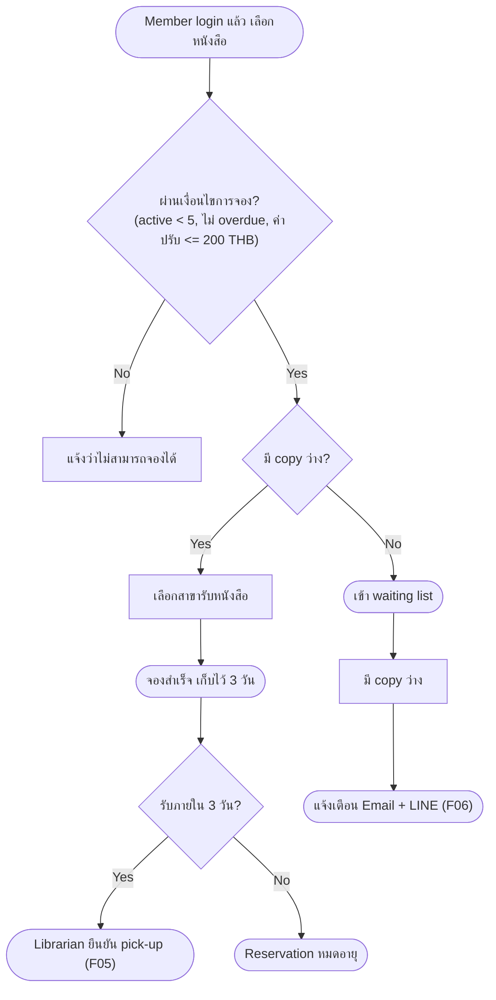

# [ALL][NEW] F03: Member reserves a book online

---

## Section 1: Document Information

|                            |                                                                        |
| -------------------------- | ---------------------------------------------------------------------- |
| **Feature Name**           | Member reserves a book online                                          |
| **Epic**                   | {#TBC: Epic ที่ feature นี้สังกัด}                                      |
| **User Story**             | {#TBC: User Story work item ID}                                        |
| **Changes**                | NEW                                                                    |
| **UI Reference**           | ไม่มี mockup ใน features/OT-1/business-requirement/reference/          |
| **Backend Specification**  | {Link}                                                                 |
| **Frontend Specification** | {Link}                                                                 |
| **Document Status**        | DRAFT                                                                  |
| **Version**                | 1.0                                                                    |
| **Last Updated**           | 2026-11-04T03:13:12Z                                                   |
| **Change Summary**         | V1.0: ครอบคลุมการจองหนังสือออนไลน์ของ Member (เลือกสาขา, pick-up ภายใน 3 วัน) และการเข้า waiting list เมื่อไม่มี copy ว่าง |
| **Document Owner**         | [TBD]                                                                  |
| **SA Owner**               | {Owner Name}                                                           |
| **Designer Owner**         | {Owner Name}                                                           |

### Legend

| Mark                                          | Meaning                                                         |
| --------------------------------------------- | --------------------------------------------------------------- |
| _(no mark)_                                   | No changes                                                      |
| <span style="color:green">green</span>        | New requirement                                                 |
| <span style="color:blue">blue</span>          | Changed from existing requirement                               |
| <span style="color:red"><del>red</del></span> | Removed from existing requirement                               |
| <span style="color:orange">orange</span>      | Designed for future support, not in current scope (not scored)  |
| **{#TBC}**                                    | To be confirmed                                                 |
| **[TBD]**                                     | To be determined                                                |
| **[รอ SA กำหนด]**                             | Technical / non-functional — รอ SA กำหนด (ไม่ใช่ open question) |

### Change History

| Version | Date (UTC)           | Author   | Summary                                  |
| ------- | -------------------- | -------- | ---------------------------------------- |
| 1.0     | 2026-11-04T03:13:12Z | [TBD] (git user.name / user.email ไม่ได้ตั้งค่า) | Initial BFS draft จาก backlog OT-1 |

---

## Section 2: Overview

### Requirement Summary

> Member ของห้องสมุด City Library ต้องการจองหนังสือที่มี copy ว่างผ่านระบบออนไลน์ และไปรับหนังสือภายใน 3 วันที่สาขาที่เลือก เพื่อไม่ต้องจองทางโทรศัพท์หรือที่เคาน์เตอร์
> ปัจจุบัน Member ต้องจองทางโทรศัพท์หรือที่เคาน์เตอร์
> _Feature นี้ครอบคลุม: การจองหนังสือที่มี copy ว่าง, การเลือกสาขารับหนังสือ, การเก็บหนังสือไว้ 3 วัน, การเข้า waiting list เมื่อไม่มี copy ว่าง, การตรวจเงื่อนไขการจอง (จำนวน active reservation, overdue, ค่าปรับ), การส่ง trigger แจ้งเตือนเมื่อหนังสือใน waiting list ว่าง_
> ผลลัพธ์ที่คาดหวัง: Member จองหนังสือหรือเข้า waiting list ได้ด้วยตนเองออนไลน์ และได้รับแจ้งทาง Email และ LINE เมื่อหนังสือว่าง

---

## Section 3: Scope Definition

### 3.1 In Scope

- Member จองหนังสือที่มี copy ว่าง โดยเลือกสาขารับหนังสือ
- หนังสือที่จองถูกเก็บไว้ให้ 3 วันที่สาขาที่เลือก
- Member เข้า waiting list เมื่อไม่มี copy ว่าง (first come, first served)
- ตรวจเงื่อนไขก่อนจอง: active reservation สูงสุด 5 รายการ, ไม่มีหนังสือเกินกำหนดคืน, ค่าปรับค้างชำระไม่เกิน 200 THB
- Member ถูกแจ้งเตือนทาง Email และ LINE เมื่อหนังสือใน waiting list ว่าง (การส่งจริงอยู่ใน F06)

### 3.2 Out of Scope

- Login ของ Member — F01: Auth / Account
- ค้นหาหนังสือและดูสถานะ copy — F02: Catalogue Search
- Member ดูรายการ reservation/loan — F04: My Loans
- Librarian ยืนยัน pick-up / return / จัดการ waiting list — F05: Librarian Pick-up & Return
- การส่ง Email และ LINE — F06: Notification (Email + LINE)
- E-books, online payment, inter-library loan (out of scope phase 1)

### 3.3 Limitations

- Member ต้อง login ด้วย library card no. + PIN ก่อนจอง
- ข้อมูล copy และสถานะหนังสือมาจาก ILS เดิม (Koha) [รอ SA กำหนด: รูปแบบการ integrate/sync กับ Koha]

---

## Section 4: High-Level Business Flow



---

## Section 5: Functional Requirements

> **Note:** Each sub-section below = 1 Functional Requirement

---

### 5.1 Reserve an available book

**User Story**

> As a `Member`, I want to reserve an available book online and choose a pick-up branch, so that I can pick it up within 3 days without calling or visiting the counter.

**References**

| Field                  | Value                                                           |
| ---------------------- | --------------------------------------------------------------- |
| Epic                   | {#TBC}                                                          |
| User Story             | {#TBC}                                                          |
| UI Reference           | ไม่มี                                                           |
| Backend Specification  | {Link}                                                          |
| Frontend Specification | {Link}                                                          |
| Menu Navigation        | {#TBC: ปุ่มจองอยู่หน้าไหน / path ใด}                             |

---

**Use Case Flow**

| Actor  | Step | Pre-condition                                   | Action                                   | Expected Result                                                     |
| ------ | ---- | ----------------------------------------------- | ---------------------------------------- | ------------------------------------------------------------------- |
| Member | 1    | Login แล้ว และหนังสือมี copy ว่างอย่างน้อย 1 สาขา | เลือกหนังสือและสั่งจอง                   | ระบบตรวจเงื่อนไขการจอง (Business Rules ข้อ 1, 3)                    |
| Member | 2    | ผ่านเงื่อนไขการจอง                               | เลือกสาขารับหนังสือ                      | {#TBC: แสดงเฉพาะสาขาที่มี copy ว่างหรือทุกสาขา}                      |
| Member | 3    | เลือกสาขาแล้ว                                    | ยืนยันการจอง                             | สร้าง reservation, copy ถูกเก็บไว้ 3 วันที่สาขาที่เลือก, แสดงผลสำเร็จ {#TBC: wording ของ toast/หน้าสำเร็จ} |
| Member | 4    | ไม่ผ่านเงื่อนไขการจอง                            | สั่งจอง                                  | ไม่สร้าง reservation และแจ้งสาเหตุ {#TBC: wording ของ error แต่ละกรณี} |

---

**Field Conditions**

| Field ID                         | Field Name     | Field Specifications                                                                 | Field Conditions                                                                                                  |
| -------------------------------- | -------------- | ------------------------------------------------------------------------------------ | ----------------------------------------------------------------------------------------------------------------- |
| `RESERVATION.RESERVE.branch`     | Pick-up branch | Field Type: {#TBC}<br>Possible Value: 4 สาขาของ City Library {#TBC: รายชื่อสาขา}<br>Mandatory: Yes | **Condition 1: When Member ยังไม่เลือกสาขา Then Do** ไม่อนุญาตให้ยืนยันการจอง<br><br>**Case 1:** {#TBC: wording ของ validation} |
| `RESERVATION.RESERVE.confirm`    | Confirm button | Field Type: Button<br>Label: {#TBC}                                                   | **Condition 1: When ผ่านเงื่อนไขและเลือกสาขาแล้ว Then Do** สร้าง reservation<br><br>**Case 1:** สถานะ reservation เริ่มต้น {#TBC: ชื่อ status} |

---

**Acceptance Criteria**

**Scenario 1: จองสำเร็จ**

```
Given   Member login แล้ว มี active reservation < 5, ไม่มีหนังสือเกินกำหนดคืน, ค่าปรับค้างชำระไม่เกิน 200 THB และหนังสือมี copy ว่าง
When    Member เลือกสาขาและยืนยันการจอง
Then    ระบบสร้าง reservation และเก็บ copy ไว้ 3 วันที่สาขาที่เลือก
```

**Scenario 2: จองไม่ได้เพราะมี active reservation ครบ 5 รายการ**

```
Given   Member มี active reservation 5 รายการ
When    Member สั่งจองหนังสือเพิ่ม
Then    ระบบไม่สร้าง reservation และแจ้งสาเหตุ
```

**Scenario 3: จองไม่ได้เพราะ overdue หรือค่าปรับค้างเกิน 200 THB**

```
Given   Member มีหนังสือเกินกำหนดคืน หรือค่าปรับค้างชำระเกิน 200 THB
When    Member สั่งจองหนังสือ
Then    ระบบไม่สร้าง reservation และแจ้งสาเหตุ
```

**Scenario 4: Reservation หมดอายุ**

```
Given   Member มี reservation ที่เก็บไว้ให้ที่สาขา
When    ครบ 3 วันแล้ว Member ยังไม่มารับหนังสือ
Then    Reservation หมดอายุ {#TBC: copy กลับเป็นว่างหรือส่งต่อคนถัดไปใน waiting list อัตโนมัติ}
```

---

### 5.2 Join waiting list when no copy is available

**User Story**

> As a `Member`, I want to join a waiting list when no copy is available, so that I am notified by email and LINE when the book is free.

**References**

| Field                  | Value                                                           |
| ---------------------- | --------------------------------------------------------------- |
| Epic                   | {#TBC}                                                          |
| User Story             | {#TBC}                                                          |
| UI Reference           | ไม่มี                                                           |
| Backend Specification  | {Link}                                                          |
| Frontend Specification | {Link}                                                          |
| Menu Navigation        | {#TBC}                                                          |

---

**Use Case Flow**

| Actor  | Step | Pre-condition                                   | Action                          | Expected Result                                                                 |
| ------ | ---- | ----------------------------------------------- | ------------------------------- | ------------------------------------------------------------------------------- |
| Member | 1    | Login แล้ว, ผ่านเงื่อนไขการจอง, ไม่มี copy ว่าง   | เลือกหนังสือและเข้า waiting list | Member ถูกเพิ่มต่อท้าย waiting list (first come, first served) {#TBC: wording ของ confirm/ผลลัพธ์} |
| System | 2    | Member อยู่ใน waiting list และมี copy ว่าง        | Copy ว่าง                        | แจ้งเตือน Member ทาง Email และ LINE (ส่งโดย F06)                                |
| Member | 3    | ได้รับแจ้งเตือน                                  | ไปรับหนังสือที่สาขา              | {#TBC: ระยะเวลาเก็บไว้หลังแจ้งเตือน (3 วันเท่ากับการจองปกติหรือไม่) และสาขาที่รับ} |

---

**Field Conditions**

| Field ID                        | Field Name         | Field Specifications                                   | Field Conditions                                                                                                                             |
| ------------------------------- | ------------------ | ------------------------------------------------------ | -------------------------------------------------------------------------------------------------------------------------------------------- |
| `RESERVATION.WAITING_LIST.join` | Join waiting list  | Field Type: Button<br>Label: {#TBC}                    | **Condition 1: When หนังสือไม่มี copy ว่าง Then Do** แสดงทางเลือกเข้า waiting list แทนการจอง<br><br>**Case 1:** {#TBC: Member อยู่ใน waiting list ของหนังสือเล่มนี้แล้ว ให้ทำอย่างไร} |
| `RESERVATION.WAITING_LIST.branch` | Pick-up branch   | {#TBC: Member เลือกสาขาตอนเข้า waiting list หรือไม่}    | {#TBC}                                                                                                                                       |

---

**Acceptance Criteria**

**Scenario 1: เข้า waiting list สำเร็จ**

```
Given   Member ผ่านเงื่อนไขการจอง และหนังสือไม่มี copy ว่าง
When    Member เข้า waiting list
Then    Member ถูกเพิ่มต่อท้าย waiting list
```

**Scenario 2: ลำดับ waiting list**

```
Given   Member หลายคนอยู่ใน waiting list ของหนังสือเล่มเดียวกัน
When    มี copy ว่าง
Then    Member ที่เข้า waiting list ก่อนได้รับสิทธิ์ก่อน (first come, first served)
```

**Scenario 3: แจ้งเตือนเมื่อว่าง**

```
Given   Member อยู่ใน waiting list
When    มี copy ว่างให้ Member
Then    Member ได้รับแจ้งเตือนทาง Email และ LINE
```

**Scenario 4: เข้า waiting list ไม่ได้เพราะไม่ผ่านเงื่อนไข**

```
Given   Member มี active reservation ครบ 5 รายการ หรือมีหนังสือเกินกำหนดคืน หรือค่าปรับค้างเกิน 200 THB
When    Member พยายามเข้า waiting list
Then    {#TBC: เงื่อนไขการจองใช้กับการเข้า waiting list ด้วยหรือไม่}
```

---

## Section 6: User Authorization Matrix

| Function                 | Member | Librarian | Branch manager |
| ------------------------ | :----: | :-------: | :------------: |
| Reserve an available book |   ✔    |     —     |       —        |
| Join waiting list        |   ✔    |     —     |       —        |

---

## Section 7: Additional Business Rules / Logic

1. **Active reservation limit:** Member มี active reservation ได้สูงสุด 5 รายการ {#TBC: reservation ที่อยู่ใน waiting list นับรวมใน 5 รายการหรือไม่}
2. **Hold period:** หนังสือที่จองถูกเก็บไว้ 3 วันที่สาขาที่เลือก หลังจากนั้น reservation หมดอายุ {#TBC: นับ 3 วันปฏิทินหรือวันทำการ และเริ่มนับเมื่อใด}
3. **Eligibility:** Member ที่มีหนังสือเกินกำหนดคืน หรือค่าปรับค้างชำระเกิน 200 THB จองไม่ได้
4. **Waiting list:** ถ้าไม่มี copy ว่าง Member เข้า waiting list แบบ first come, first served
5. **Notification:** แจ้งเตือน Member ทาง Email และ LINE เมื่อหนังสือที่จองพร้อมรับ (ส่งโดย F06) {#TBC: ถ้าส่งช่องทางใดช่องทางหนึ่งไม่สำเร็จให้ทำอย่างไร}
6. **Data source:** สถานะ copy และข้อมูล Member (overdue, ค่าปรับ) มาจาก ILS เดิม (Koha) [รอ SA กำหนด: วิธีดึง/sync ข้อมูลและการกันจองซ้ำเมื่อ request พร้อมกัน]

---

## Section 8: Related Documents

| Document Name                                          | Document Link                                                         |
| ------------------------------------------------------ | --------------------------------------------------------------------- |
| F03: Member reserves a book online (Input Requirement) | features/OT-1/business-requirement/input/requirement.md               |
| Project Context Guidance                               | INIT/project-overview/version-1/context-guidance.md                   |
| F06: Notification (Email + LINE)                       | [TBD]                                                                 |
| F05: Librarian Pick-up & Return                        | [TBD]                                                                 |

---
